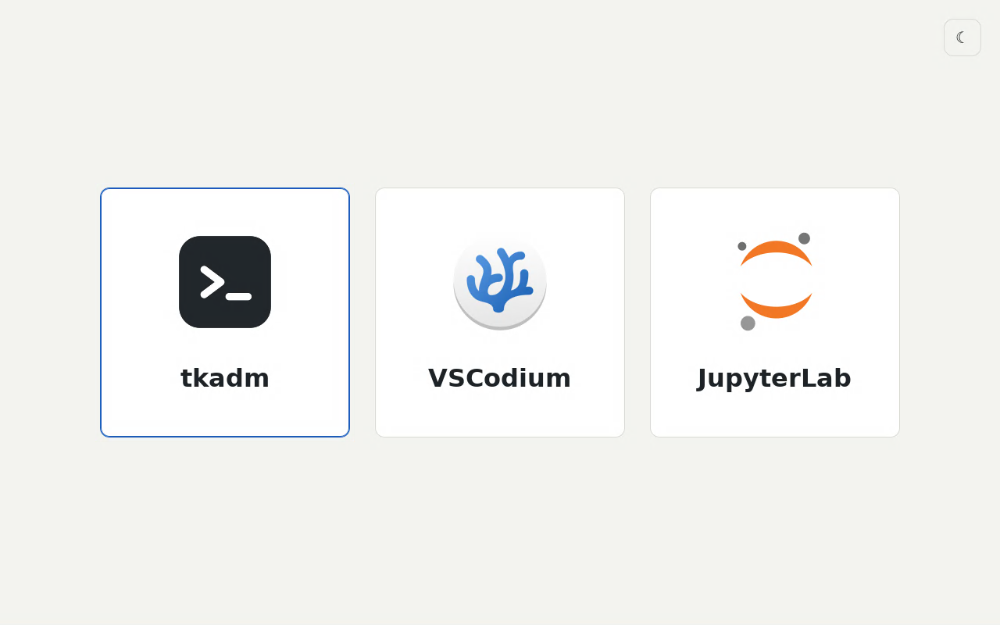
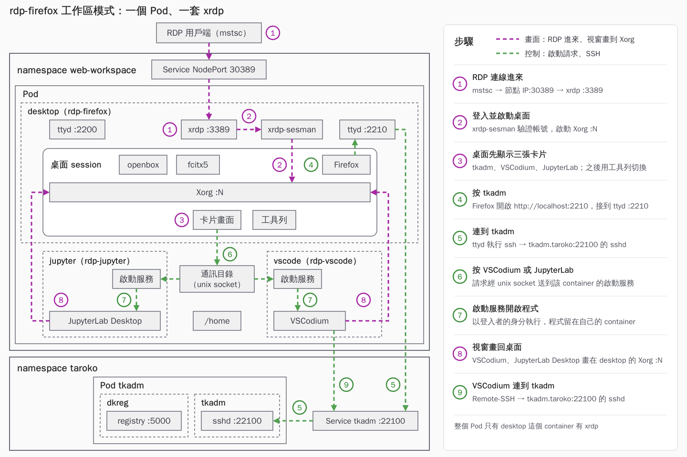

# rdp-firefox

rdp-firefox 讓你用 Windows 內建的遠端桌面（RDP）登入 Kubernetes 叢集裡的桌面，直接使用叢集內的服務。它有兩種模式：

- **工作區模式**：登入後是三張卡片，按一下就開啟 tkadm（叢集內的管理 Pod，用來執行 kubectl）、VSCodium（開源版的 VS Code）或 JupyterLab（瀏覽器裡的筆記本環境）。
- **kiosk 模式**：登入後是全螢幕的 Firefox，裡面可以開 Web 終端機。多人可以同時使用，每人各有獨立的桌面，也能把桌面分享給別人看或一起操作。

適合不想把叢集內的 Web 服務對外開放、也不想把 kubeconfig（kubectl 連線叢集用的設定檔）帶出叢集，又要讓幾個人方便使用的情境。

## Key Features

- **桌面就在叢集裡**：登入後直接存取叢集內的服務，只需要開放一個 NodePort（Kubernetes 在每個節點上開放的固定埠號）`30389`，不用另外安裝負載平衡器（例如 MetalLB、kube-vip）。
  - **Web**：Firefox 以 `http://<service>.<namespace>` 開啟叢集內的 Web 應用，例如 `http://grafana.monitoring`。namespace 是叢集裡用來分隔資源的空間。
  - **CLI**：`localhost:2210` 以 SSH 連到 tkadm 操作 Kubernetes，kubeconfig 不必離開叢集。
- **Windows 不必安裝用戶端**：用內建的「遠端桌面連線」就能登入；macOS 用 Windows App。
- **一行指令部署到 Kubernetes**：兩種模式都只要一行指令，不需要叢集提供儲存空間（PersistentVolume、StorageClass）。
- **一個桌面、三個工具**（工作區模式）：tkadm、VSCodium、JupyterLab 共用一次登入，不必分別連三個遠端桌面；斷線 8 小時內重新連線，會接回原本的桌面。
- **多人同時使用、各有桌面**（kiosk 模式）：多個帳號、甚至同一個帳號都能多人同時登入，每次登入都有自己的桌面、瀏覽器與下載目錄。
- **桌面內可以輸入中文**：內建新酷音（注音），按左 `Shift` 切換中英；也能貼上本機複製的文字。
- **用 PIN 分享桌面**（kiosk 模式）：把操作 PIN 或唯讀 PIN 告訴對方，對方就能一起操作或只能看。一行指令安裝的映像檔已經內建這個功能，用法見[使用手冊](docs/user-guide.md#5-分享你的桌面)。

## Quick Start

先準備好：

- 執行指令的電腦上要有 `kubectl`。工作區模式還要有 `git`（`kubectl` 會用它把這個 repo 抓下來），kiosk 模式還要有 `curl` 和 `bash`。
- `kubectl` 已經連上叢集，而且有權限建立 Namespace、Deployment、Service、Secret。執行 `kubectl get nodes` 列得出節點（叢集裡的機器），就表示已經連上。
- 節點要能連到 `ghcr.io` 下載映像檔。映像檔是公開的，不需要帳號密碼。
- 有一個節點放得下整個 Pod（Kubernetes 執行 container 的最小單位）：工作區模式要求 0.8 核心、2 GiB 記憶體，kiosk 模式要求 1 核心、2 GiB。
- NodePort `30389` 沒有被占用，而且你的電腦連得到節點的 TCP 30389 埠。
- 遠端桌面用戶端：Windows 用內建的「遠端桌面連線」（`mstsc`）；macOS 用 Mac App Store 的 Windows App，新增 PC 時 Credentials 選 **Ask when required**，才會出現登入畫面。

已在 Kubernetes v1.37 測試過。

兩種模式用同一個 NodePort，**同一個叢集只能裝其中一種**。

### 工作區模式（tkadm、VSCodium、JupyterLab）

一行指令部署：

```bash
kubectl apply -k "https://github.com/braveantony/rdp-firefox//manifests/workspace?ref=main"
```

這會建立 `web-workspace` 這個 namespace，以及裡面存放帳號密碼的 Secret、NodePort Service，和一個有三個 container 的 Deployment（負責建立 Pod 並讓它持續執行）。

等 Pod 變成 `3/3 Running` 就可以連線。第一次要下載三個映像檔，需要幾分鐘；看到 `3/3 Running` 後按 `Ctrl+C` 離開：

```bash
kubectl -n web-workspace get pod -w
```

用遠端桌面連線到 `<節點 IP>:30389`，帳號 `bigred`、密碼 `bigred`。節點 IP 用 `kubectl get nodes -o wide` 查，看 `INTERNAL-IP` 欄，任一個節點都可以。連線時會先出現憑證警告和 xrdp 登入畫面，步驟見[使用手冊的「連線與登入」](docs/user-guide.md#1-連線與登入)。登入後是三張卡片：



tkadm 要另外部署，本 repo 不提供，見 [Known Limitations](#known-limitations)。

卡片和工具列怎麼用、修改帳號密碼、給多人同時使用、在 Pod 重建後保留家目錄的檔案，以及移除部署的步驟，都在 [docs/workspace-mode.md](docs/workspace-mode.md)。

### kiosk 模式（全螢幕 Firefox）

一行指令部署：

```bash
curl -fsSL https://raw.githubusercontent.com/braveantony/rdp-firefox/main/install.sh | bash
```

腳本會部署到 namespace `web-workspace`，完成後印出每個節點的連線位址。用遠端桌面連線到 `<節點 IP>:30389`，帳號 `bigred`、密碼 `bigred`。連線時會先出現憑證警告和 xrdp 登入畫面，步驟見[使用手冊的「連線與登入」](docs/user-guide.md#1-連線與登入)。登入後是全螢幕的 Firefox：


設定多個帳號、更換映像檔、升級與移除的步驟，都在 [docs/install.md](docs/install.md)。Firefox、Web 終端機、輸入中文和分享桌面怎麼用，見[使用手冊](docs/user-guide.md)。

## Configuration

所有設定都用環境變數，沒設定的就用預設值。

| 變數 | 預設值 | 說明 |
| --- | --- | --- |
| `USERS_FILE` | `/etc/firefox-rdp/users` | 帳號檔案，一行一個 `帳號:密碼`；Kubernetes 上由 Secret 掛載（kiosk 模式是 `firefox-rdp-users-*`；工作區模式是 `workspace-users-*`，路徑設成 `/etc/workspace/users`）。檔案存在且非空時忽略下面兩個變數 |
| `RDP_USER` | `bigred` | 沒有帳號檔案時的登入帳號（UID 1000） |
| `RDP_PASSWORD` | — | 沒有帳號檔案時的登入密碼（此時必填） |
| `MAX_SESSIONS` | `4` | 可同時存在的桌面數上限；加入別人桌面的連線不占名額。只能分享編號 10～19 的桌面，設超過 10 時，多出來的桌面無法分享 |
| `RDP_MODE` | `kiosk` | `kiosk`：登入後是全螢幕的 Firefox；`workspace`：[工作區模式](docs/workspace-mode.md) |
| `DISCONNECTED_TIMEOUT` | `28800` | 只在工作區模式有效：斷線後桌面保留的秒數 |
| `SSH_TARGET` | `tkadm.taroko` | `localhost:2210` 終端機的 SSH 目標。連 `tkadm.taroko` 時自動使用 22100 埠（`/etc/ssh/ssh_config.d/tkadm.conf`）；其他主機要指定埠號時寫成 `ssh://<主機>:<埠>` |

在 Kubernetes 上怎麼改帳號和映像檔，kiosk 模式見 [docs/install.md](docs/install.md)，工作區模式見 [docs/workspace-mode.md](docs/workspace-mode.md)。各版本映像檔的差異見 [docs/versions.md](docs/versions.md)。

## How It Works



上圖是工作區模式，編號對應右側的步驟。

**連線。** 使用者以 RDP 連到任一節點的 NodePort `30389`，Service 把連線轉到 Pod 的 3389 埠，由 Pod 裡的 xrdp（Linux 上的 RDP 伺服器）接手。帳號密碼通過驗證後，xrdp-sesman 啟動桌面：kiosk 模式每條連線一個，工作區模式每個帳號一個。桌面裡的程式都在叢集內執行，所以能直接連到叢集內的服務。

**工作區模式。** 一個 Pod 裡有三個 container，各用自己的映像檔：`desktop`（rdp-firefox）負責 xrdp、桌面、卡片與工具列，`vscode`（rdp-vscode）執行 VSCodium，`jupyter`（rdp-jupyter）執行 JupyterLab。按下 VSCodium 或 JupyterLab 的卡片時，桌面透過 unix socket（同一台機器上的程式互相通訊用的檔案）通知對應的 container，由它以登入者的身分啟動程式，視窗直接畫在桌面上。tkadm 則是 `desktop` 自己開的 Firefox 視窗，裡面是連到 tkadm 的 Web 終端機。斷線後桌面和裡面的工具會保留 8 小時，重新連線就接回原本的桌面。

**kiosk 模式。** Pod 只有 `desktop` 一個 container。每條連線登入後，都會拿到一個全新的桌面和全螢幕的 Firefox；斷線 2 分鐘後桌面就關閉。Web 終端機（`localhost:2200`、`localhost:2210`）和分享桌面用的連線都只在 Pod 內部開放，從叢集外連不到。

**Web 終端機。** 兩種模式都有。`localhost:2200` 是 bash，`localhost:2210` 以 SSH 連到 `SSH_TARGET`（預設是 tkadm），所以 kubeconfig 留在 tkadm 裡，不必帶到用戶端。

工作區模式的細節見 [docs/workspace-mode.md](docs/workspace-mode.md)。kiosk 模式的架構圖、各個 process（執行中的程式）的職責與安全邊界，見 [docs/architecture.md](docs/architecture.md)。

從零建置映像檔的步驟見 [docs/build-image-v3.4.md](docs/build-image-v3.4.md) 和 [docs/build-image.md](docs/build-image.md)；測試在 `test/` 底下，工作區模式的測試怎麼執行見 [docs/workspace-mode.md 的「測試」](docs/workspace-mode.md#測試)。

## Known Limitations

- **兩種模式不能裝在同一個叢集。** kiosk 模式和工作區模式都用 NodePort `30389`，也都裝在 namespace `web-workspace`。
- **預設的帳號密碼是公開的。** 兩種模式的一行指令都建立 `bigred`／`bigred`，只適合測試；正式使用前請換成自己的帳號密碼。
- **所有桌面都在同一個 Pod 裡。** 升級、修改帳號或節點故障讓 Pod 重建時，所有使用中的連線都會中斷。
- **同時最多 4 個桌面。** 所有帳號合計，用 `MAX_SESSIONS` 調整。斷線後還沒關閉的桌面也算在內：kiosk 模式保留 2 分鐘，工作區模式預設保留 8 小時。
- **檔案帶不回本機。** 映像檔關閉了遠端桌面的磁碟與音效重新導向，所以桌面裡下載的檔案無法透過磁碟對應拿回自己的電腦，也沒有聲音。
- **kiosk 模式斷線後無法接回原本的桌面。** 每次登入都是全新的桌面，原本的分頁與下載的檔案會在斷線 2 分鐘後清除。
- **工作區模式的家目錄預設不會保留。** `/home` 是跟著 Pod 存在的暫時空間：斷線重連後檔案還在，Pod 重建就清空。要保留時自己加上 PVC（向叢集申請的一塊儲存空間），見 [docs/workspace-mode.md 的「保留 home 的檔案」](docs/workspace-mode.md#保留-home-的檔案)。
- **工作區模式預設只替一個帳號保留資源。** 一個帳號把四個工具都開起來大約用 2 GiB 記憶體；節點不夠大時，第二個帳號開啟工具就可能把記憶體用滿。多人同時使用要調高，見 [docs/workspace-mode.md 的「資源與人數」](docs/workspace-mode.md#資源與人數)。
- **工作區模式不能分享桌面。** 登入畫面的 Session 選單仍會列出 `join10`～`join19`，但選了會連線失敗。
- **工作區模式的帳號之間只有檔案權限的隔離。** 其他帳號讀不到你的家目錄，但任何帳號都能開啟全部的工具，沒有依帳號限制的功能。
- **加入別人的桌面時，畫面大小固定與分享者相同。** 視窗無法放大到全螢幕；需要時在遠端桌面連線的標題列按右鍵，勾選「智慧型調整大小」（Smart sizing），畫面就會跟著視窗縮放。
- **tkadm 要另外部署。** 沒有 tkadm 時，`localhost:2210` 和工作區模式的 tkadm 視窗連不上，VSCodium 也連不到 tkadm；VSCodium 和 JupyterLab 本身仍可開啟。可以用 `SSH_TARGET` 改連其他主機。
- **映像檔只提供 `linux/amd64`。**

## License

以 [MIT License](LICENSE) 授權。
