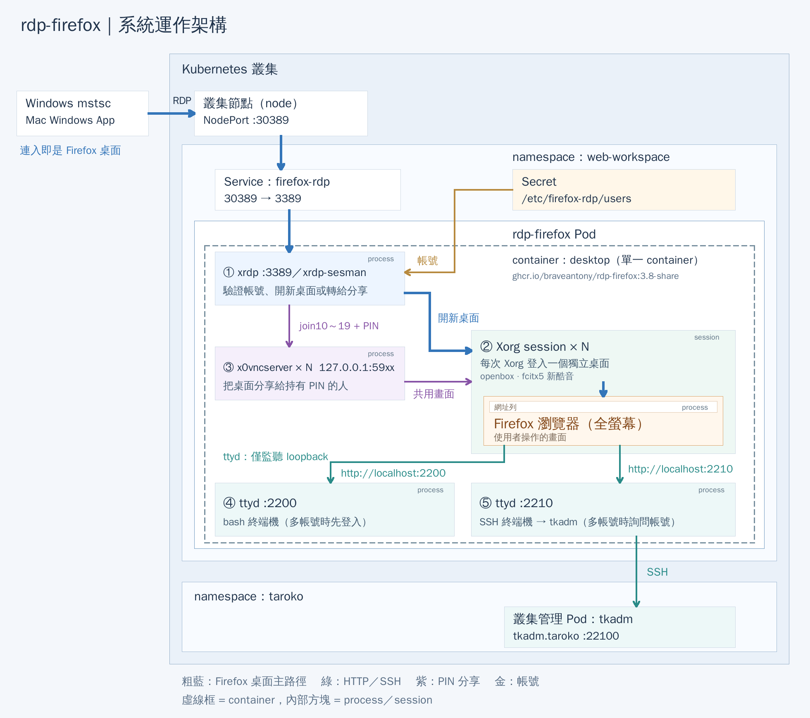
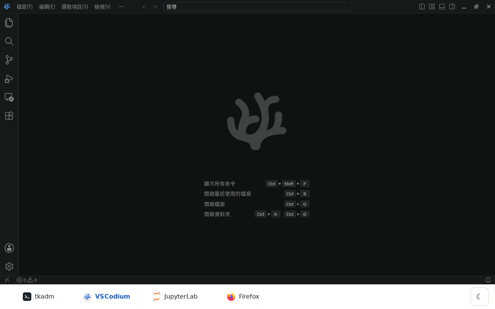

# rdp-firefox

rdp-firefox 讓你用 Windows 內建的遠端桌面（RDP）登入 Kubernetes 叢集裡的桌面，直接使用叢集內的服務。它有兩種模式：

- **kiosk 模式**（預設）：登入後是全螢幕的 Firefox 與 Web 終端機。支援多人同時使用，每人各有獨立桌面，也能分享給別人觀看或共同操作。
- **工作區模式**：登入後是三張卡片，按一下就開啟 tkadm、VSCodium 或 JupyterLab。

適合不想把叢集內的 Web 服務和 kubeconfig（kubectl 連線叢集用的設定檔）開放到叢集外，又要讓幾個人方便使用的情境。

## Key Features

- **叢集的入口，Web 與 CLI 兼備**：登入後的桌面就在 Kubernetes 叢集裡，直接存取叢集內的服務
  - **Web**：Firefox 以 `http://<service>.<namespace>`（Service 名稱加上所在的 namespace，以半形句點 `.` 分隔，例如 `http://grafana.monitoring`）直達叢集內的 Web 應用
  - **CLI**：`localhost:2210` 以 SSH 連到叢集內的管理 Pod（tkadm）操作 Kubernetes，kubeconfig 不必離開叢集
  - 只需開放一個 NodePort（30389），叢集內的 Web 服務不必另外對外開放，也不用裝 MetalLB 或 kube-vip
- **零安裝、即連即用**：Windows 內建遠端桌面一鍵連線，免裝任何用戶端或外掛
- **一行指令部署到 Kubernetes**：兩種模式都只要一行指令，不需要 PersistentVolume 或 StorageClass
- **多人並行、彼此隔離**（kiosk 模式）：多個帳號、甚至同一帳號都能多人同時登入，每次登入都有自己的桌面、瀏覽器與下載目錄，每個終端機分頁也各有獨立的 shell，互不干擾
- **一個桌面、三個工具**（工作區模式）：tkadm、VSCodium、JupyterLab 在同一個桌面裡切換；整個 Pod 只有一套 xrdp，重新連線會接回原本的桌面
- **中文輸入無縫接軌**：桌面內建新酷音（注音），按左 `Shift` 即可切換中英；也能從本機剪貼簿直接貼上
- **即時協作、權限分明**（kiosk 模式的 `-share` 版）：一組 PIN 即可邀請他人加入你的桌面，唯讀觀摩或共同操作由你決定

## Quick Start

先準備好：

- 執行指令的電腦上要有 `kubectl`。工作區模式還要有 `git`（`kubectl` 會用它把這個 repo 抓下來），kiosk 模式還要有 `curl` 和 `bash`。
- `kubectl` 已經連上叢集，而且有權限建立 Namespace、Deployment、Service、Secret。執行 `kubectl get nodes` 列得出節點（叢集裡的機器），就表示已經連上。
- 節點要能連到 `ghcr.io` 下載映像檔。映像檔是公開的，不需要帳號密碼。
- 有一個節點放得下整個 Pod：工作區模式要求 0.8 核心、2 GiB 記憶體，kiosk 模式要求 1 核心、2 GiB。
- NodePort（Kubernetes 在每個節點上開放的固定埠號）`30389` 沒有被占用，而且你的電腦連得到節點的 TCP 30389 埠。
- 遠端桌面用戶端：Windows 用內建的「遠端桌面連線」（`mstsc`）；macOS 用 Mac App Store 的 Windows App。

已在 Kubernetes v1.37 測試過。

兩種模式用同一個 NodePort，**同一個叢集只能裝其中一種**。

### 工作區模式（tkadm、VSCodium、JupyterLab）

一行指令部署：

```bash
kubectl apply -k "https://github.com/braveantony/rdp-firefox//manifests/workspace?ref=main"
```

這會建立 `web-workspace` 這個 namespace（叢集裡用來分隔資源的空間），以及裡面存放帳號密碼的 Secret、NodePort Service，和一個有三個 container 的 Deployment。

確認已經在執行。第一次要下載三個映像檔，需要幾分鐘，Pod 變成 `3/3 Running` 就可以連線：

```bash
kubectl -n web-workspace get pod -w
```

用遠端桌面連線到 `<節點 IP>:30389`（節點 IP 用 `kubectl get nodes -o wide` 查），帳號 `bigred`、密碼 `bigred`。登入後是三張卡片：


tkadm 要另外部署，本 repo 不提供；沒有 tkadm 時，VSCodium 和 JupyterLab 照常可用，只有 tkadm 視窗連不上。

修改帳號密碼、給多人同時使用、在 Pod 重建後保留 `/home` 的檔案，以及移除部署的步驟，都在 [docs/workspace-mode.md](docs/workspace-mode.md)。

### kiosk 模式（全螢幕 Firefox）

一行指令部署：

```bash
curl -fsSL https://raw.githubusercontent.com/braveantony/rdp-firefox/main/install.sh | bash
```

腳本會部署到 namespace `web-workspace`，完成後印出每個節點的連線位址。用遠端桌面連線到 `<節點 IP>:30389`，帳號 `bigred`、密碼 `bigred`。登入後是全螢幕的 Firefox：


多個帳號（Kustomize）、更換映像檔、升級與移除的步驟，都在 [docs/install.md](docs/install.md)。

## Configuration

### 環境變數

所有設定都用環境變數，沒設定的就用預設值。

| 變數 | 預設值 | 說明 |
| --- | --- | --- |
| `USERS_FILE` | `/etc/firefox-rdp/users` | 帳號檔案，一行一個 `帳號:密碼`；Kubernetes 上由 Secret `firefox-rdp-users-*` 掛載。檔案存在且非空時忽略下面兩個變數 |
| `RDP_USER` | `bigred` | 沒有帳號檔案時的登入帳號（UID 1000） |
| `RDP_PASSWORD` | — | 沒有帳號檔案時的登入密碼（此時必填） |
| `MAX_SESSIONS` | `4` | 可同時存在的桌面數上限；加入別人桌面的連線不占名額。`-share` 版只能分享編號 10～19 的桌面，設超過 10 時，多出來的桌面無法分享 |
| `RDP_MODE` | `kiosk` | `kiosk`：登入後是全螢幕的 Firefox；`workspace`：[工作區模式](docs/workspace-mode.md) |
| `DISCONNECTED_TIMEOUT` | `28800` | 只在工作區模式有效：斷線後桌面保留的秒數 |
| `SSH_TARGET` | `tkadm.taroko` | `localhost:2210` 終端機的 SSH 目標。連 `tkadm.taroko` 時自動使用 22100 埠（`/etc/ssh/ssh_config.d/tkadm.conf`）；其他主機要指定埠號時寫成 `ssh://<主機>:<埠>` |

在 Kubernetes 上怎麼改帳號和映像檔，kiosk 模式見 [docs/install.md](docs/install.md)，工作區模式見 [docs/workspace-mode.md](docs/workspace-mode.md)。

### 版本比較

| | v3.2 | v3.4-share | v3.5-share | v3.6-share | v3.7-share | v3.8-share |
| --- | --- | --- | --- | --- | --- | --- |
| 映像檔 | `ghcr.io/braveantony/rdp-firefox:3.2` | `ghcr.io/braveantony/rdp-firefox:3.4-share` | `ghcr.io/braveantony/rdp-firefox:3.5-share` | `ghcr.io/braveantony/rdp-firefox:3.6-share` | `ghcr.io/braveantony/rdp-firefox:3.7-share` | `ghcr.io/braveantony/rdp-firefox:3.8-share` |
| 同一帳號多人同時登入、各自獨立桌面 | ✅ | ✅ | ✅ | ✅ | ✅ | ✅ |
| localhost:2200／2210 Web 終端機 | ✅ | ✅ | ✅ | ✅ | ✅ | ✅ |
| 分享自己的桌面（操作 PIN／唯讀 PIN） | — | ✅ | ✅ | ✅ | ✅ | ✅ |
| 多個帳號（Secret 帳號檔案） | — | — | ✅ | ✅ | ✅ | ✅ |
| `curl \| bash` 安裝、Kustomize 部署 | — | — | ✅ | ✅ | ✅ | ✅ |
| 桌面內直接輸入中文（新酷音） | — | — | — | ✅ | ✅ | ✅ |
| 2210 免設定直連 tkadm（22100 埠）、設定多個帳號時詢問 SSH 帳號 | — | — | — | — | ✅ | ✅ |
| [工作區模式](docs/workspace-mode.md)（`RDP_MODE=workspace`） | — | — | — | — | — | ✅ |
| 映像檔大小 | 約 790 MB | 約 1.04 GB | 約 1.04 GB | 約 1.08 GB | 約 1.08 GB | 約 1.12 GB |
| 原始碼 | branch [`release/3.2`](../../tree/release/3.2) | branch [`release/3.4-share`](../../tree/release/3.4-share) | branch [`release/3.5-share`](../../tree/release/3.5-share) | branch [`release/3.6-share`](../../tree/release/3.6-share) | branch [`release/3.7-share`](../../tree/release/3.7-share) | branch [`release/3.8-share`](../../tree/release/3.8-share) |

`images/rdp-firefox/Dockerfile` 用建置參數 `SESSION_SHARE` 區分是否加入分享功能：`SESSION_SHARE=1` 建出 `-share` 版；`SESSION_SHARE=0`（預設）建出不含分享功能的版本（此版本未另外發布映像檔）。各版本的差異說明見 [Releases](../../releases)。

## How It Works



使用者以 RDP 連到任一節點的 NodePort `30389`，Service 把連線轉到 Pod 的 3389 埠，由 Pod 裡的 xrdp 接手。帳號密碼通過驗證後，xrdp 為這條連線啟動一個桌面，桌面裡的程式都在叢集內執行，所以能直接連到叢集內的服務。

上圖是 kiosk 模式。Pod 內各個 process（執行中的程式）的職責與安全邊界，見 [docs/architecture.md](docs/architecture.md)；完整的操作說明見[使用手冊](docs/user-guide.md)。

### 登入

按 `Win+R`、輸入 `mstsc`，開啟「遠端桌面連線」，連到 `<節點 IP>:30389`。出現憑證警告時按「是」（憑證是 Pod 每次啟動時自行產生的自簽憑證，所以 Pod 重建後會再出現一次）。接著會看到 xrdp 登入畫面：Session 保持 `Xorg`，輸入帳號密碼後按 OK。


### Firefox

kiosk 模式登入後，畫面上只有全螢幕的 Firefox。關掉它會在 1 秒內自動重開；解析度會配合遠端桌面視窗大小調整。下載檔案時會詢問儲存位置。

輸入中文：本機輸入法保持英文，在遠端桌面裡單獨按一下左 `Shift`（或 `Ctrl+Space`）切換到注音（新酷音），再按一次切回英文。也可以在本機打好後複製，再到 Firefox 按 `Ctrl+V` 貼上（Mac 用 `Cmd+V`）。

在網址列輸入 `http://<service>.<namespace>` 即可開啟叢集內的 Web 服務，不必另外把該服務開放到叢集外。服務的埠號不是 80 時，在網址後加上 `:<埠號>`，例如 `http://grafana.monitoring:3000`；埠號就是 Service 的 port，可用 `kubectl get svc -n <namespace>` 查看。

### Web 終端機

在 Firefox 網址列輸入 `localhost:2200` 就是 bash 終端機，`localhost:2210` 則以 SSH 連到 `SSH_TARGET`（預設 `tkadm.taroko`；映像檔已預先設定好，連 tkadm 時會自動使用 22100 埠）。每個分頁都有獨立的 shell，關掉分頁就會結束；除了多帳號模式的 `localhost:2200`（使用該帳號的家目錄，檔案會保留）之外，分頁裡的家目錄都是暫時的，關掉分頁就刪除。終端機只能在遠端桌面裡的 Firefox 開啟，從你自己電腦的瀏覽器連不到。

在終端機裡貼上請按 `Ctrl+Shift+V` 或 `Shift+Insert`（Mac 上是 `Control+Shift+V`），因為 `Ctrl+V` 會被當成控制字元送進終端機。

只設定一個帳號時，`localhost:2200` 直接以該帳號開啟 bash；設定多個帳號時，會先出現 `login:` 提示，輸入自己的帳號密碼後才進入 bash，避免不小心以別人的身分操作；同一帳號開的多個分頁共用該帳號的家目錄。`localhost:2210` 在只設定一個帳號時，以同名帳號 SSH 登入（需輸入 SSH 目標上的密碼）；設定多個帳號時，會先詢問要用 SSH 目標上的哪個帳號。


### 分享你的桌面（kiosk 模式的 `-share` 版）

登入約 2 秒後，畫面中央會出現這個桌面的**編號**、**操作 PIN**（可以操作）與**唯讀 PIN**（只能看）。依需要把其中一組 PIN 告訴對方即可。關掉視窗後，可按 `Ctrl+Alt+S` 再次叫出；**開始分享前請先關掉這個視窗**，以免加入者看到操作 PIN。


### 加入別人的桌面

1. 同樣用遠端桌面連到同一個位址，會出現 xrdp 登入畫面。
2. **Session** 改選 `join<編號>`（例如 `join10`；編號從 10 起，可分享的是 10～19），可用滑鼠選或按 `↓` 鍵。

   

3. 表單只剩 **password** 一欄，填入對方給的 PIN，按 OK。

   

4. 加入後就會看到對方的畫面：用唯讀 PIN 時所有輸入都無效，用操作 PIN 時可以一起操作（滑鼠鍵盤與對方共用）。分享不限帳號：任何人只要拿到 PIN 都能加入。

   

> 不要在 username 填 `join10\bigred` 之類的名稱：Session 仍是 `Xorg` 時會被當成帳號而登入失敗。

### 工作區模式

一個 Pod 裡有三個 container，各用自己的映像檔：`desktop`（rdp-firefox）負責 xrdp、桌面、卡片與工具列，`vscode`（rdp-vscode）執行 VSCodium，`jupyter`（rdp-jupyter）執行 JupyterLab。按下卡片時，桌面透過 unix socket（同一台機器上的程式互相通訊用的檔案）通知另一個 container，由它以登入者的身分啟動程式，視窗直接畫在桌面上。工具開啟後，畫面底部的工具列可以在四個工具（多了 Firefox）之間切換：



細節見 [docs/workspace-mode.md](docs/workspace-mode.md)。

從零建置映像檔的步驟見 [docs/build-image-v3.4.md](docs/build-image-v3.4.md)（`:3.4` 與 `:3.4-share`）和 [docs/build-image.md](docs/build-image.md)（v3.2）。測試在 `test/` 底下：`test/e2e/` 在臨時的 kind 叢集（用容器模擬的測試用 Kubernetes 叢集）上做端到端驗證，`test/unit/` 與 `test/image/` 測工作區模式，`test/architecture/` 對已部署的叢集核對架構文件的說法。

## Known Limitations

- **兩種模式不能裝在同一個叢集。** kiosk 模式和工作區模式都用 NodePort `30389`，也都裝在 namespace `web-workspace`。
- **預設的帳號密碼是公開的。** 兩種模式的一行指令都建立 `bigred`／`bigred`，只適合測試；正式使用前請換成自己的帳號密碼。
- **所有桌面都在同一個 Pod 裡。** 升級、修改帳號或節點故障讓 Pod 重建時，所有使用中的連線都會中斷。
- **kiosk 模式斷線後無法接回原本的桌面。** 每次登入都是全新的桌面，原本的分頁與下載的檔案會在斷線 2 分鐘後清除。
- **同時最多 4 個桌面**（所有帳號合計），用 `MAX_SESSIONS` 調整；工作區模式一個帳號一個桌面，所以也就是同時使用的帳號數。
- **工作區模式的 `/home` 預設不會保留。** `/home` 是跟著 Pod 存在的暫時空間：斷線重連後檔案還在，Pod 重建就清空。要保留時自己加上 PVC（向叢集申請的一塊儲存空間），見 [docs/workspace-mode.md 的「保留 home 的檔案」](docs/workspace-mode.md#保留-home-的檔案)。
- **工作區模式的預設資源只夠一個帳號。** 一個帳號把四個工具都開起來大約用 2 GiB 記憶體，多人同時使用要調高，見 [docs/workspace-mode.md 的「資源與人數」](docs/workspace-mode.md#資源與人數)。
- **工作區模式不能分享桌面。** 登入畫面的 Session 選單仍會列出 `join10`～`join19`，但選了會連線失敗。
- **工作區模式的帳號之間只有檔案權限的隔離。** 其他帳號讀不到你的 home，但誰能用哪個工具靠約定，不靠權限。
- **加入別人的桌面時，畫面大小固定與分享者相同。** 視窗無法放大到全螢幕；需要時在遠端桌面連線的標題列按右鍵，勾選「智慧型調整大小」（Smart sizing），畫面就會跟著視窗縮放。
- **tkadm 要另外部署。** 沒有 tkadm 時，`localhost:2210` 和工作區模式的 tkadm 視窗無法使用；可以用 `SSH_TARGET` 改連其他主機。
- **映像檔只提供 `linux/amd64`。**

## License

以 [MIT License](LICENSE) 授權。
