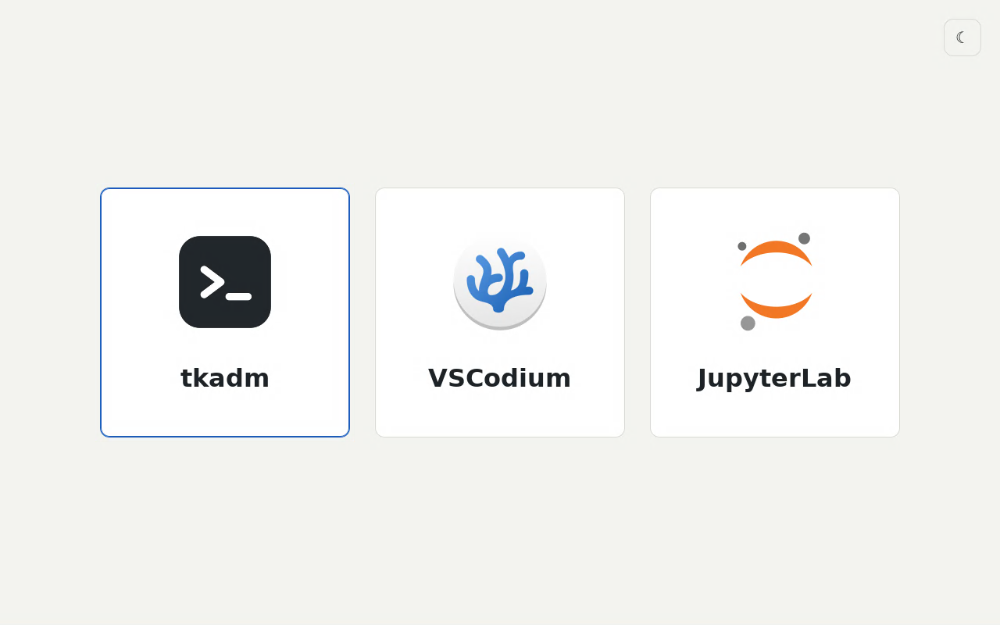
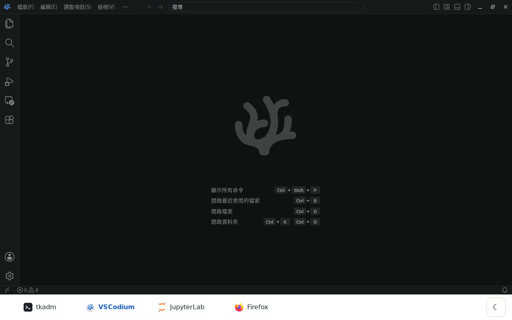

# 工作區模式

適用映像檔：`ghcr.io/braveantony/rdp-firefox:3.8-share`。

## 一句話

登入一個遠端桌面，就能開啟 tkadm、VSCodium、JupyterLab 三個工具；整個 Pod 只有一套 xrdp。



## 什麼時候用

預設的 **kiosk 模式**下，登入後只有一個全螢幕的 Firefox。要用 VSCodium 或 JupyterLab，得另外連到 rdp-vscode、rdp-jupyter 各自的遠端桌面，每一個都有自己的 xrdp。

工作區模式把三個工具放進同一個桌面：

| | kiosk 模式（預設） | 工作區模式 |
| --- | --- | --- |
| 設定 | 不設定，或 `RDP_MODE=kiosk` | `RDP_MODE=workspace` |
| 登入後看到 | 全螢幕的 Firefox | 三張卡片：tkadm、VSCodium、JupyterLab |
| 桌面 | 每條連線一個，斷線 2 分鐘後關閉 | 每個帳號一個，重新連線會接回原本的桌面 |
| home | 每條連線一個暫時的 home | 帳號自己的 `/home/<帳號>`，檔案會保留 |
| 分享桌面（`-share` 版） | 可以 | 不啟用，見[限制](#限制) |

## 怎麼用

1. 用遠端桌面連線登入，畫面上是三張卡片。
2. 按一張卡片，工具開啟後畫面底部會出現工具列。
3. 工具列上有四個工具（多了 Firefox）。按一下：還沒開的會啟動，已經開的會切換過去。
4. 工具列上的字表示狀態：

   | 樣子 | 意思 |
   | --- | --- |
   | 黑色字 | 還沒開啟 |
   | 名稱後面有 `…` | 啟動中 |
   | 藍色字 | 已開啟 |
   | 藍色粗體字 | 目前的視窗 |
   | 名稱後面有 `!` | 啟動失敗，再按一次會重試 |

5. 最右邊的按鈕切換深色與淺色，選擇會記住。它只改變卡片和工具列，三個工具各自的主題不會跟著變。



tkadm 視窗是一個 Firefox，開啟 `localhost:2210` 的 Web 終端機（以 SSH 連到 `SSH_TARGET`）。JupyterLab 第一次開啟大約需要半分鐘。

## 怎麼運作

一個 Pod 裡有三個 container，各用自己的映像檔：

| container | 映像檔 | 模式 | 做什麼 |
| --- | --- | --- | --- |
| `desktop` | rdp-firefox | `RDP_MODE=workspace` | xrdp、桌面、卡片與工具列、tkadm 與 Firefox 視窗 |
| `vscode` | rdp-vscode | `RDP_MODE=attached` | 執行 VSCodium |
| `jupyter` | rdp-jupyter | `RDP_MODE=attached` | 執行 JupyterLab |

按下 VSCodium 或 JupyterLab 時：

1. 桌面（`/opt/desktop/workspace/workspace.py`）連到 `/run/rdp-workspace/vscode.sock` 或 `jupyter.sock`（unix socket，同一台機器上的程式互相通訊用的檔案），送出自己的畫面編號，例如 `:10`。
2. 另一個 container 裡的啟動服務由 Linux 核心得知是哪個帳號連線，以那個帳號的身分啟動程式。
3. 同一個 Pod 共用網路，程式的視窗直接畫在桌面這邊的畫面上。

啟動服務的細節見 rdp-vscode 與 rdp-jupyter 的 `docs/attached-mode.md`。

## 部署

### 部署前先確認

| 要確認的事 | 怎麼查 | 不符合時 |
| --- | --- | --- |
| 有一個節點放得下整個 Pod：三個 container 合計要求 2 核心、4 GiB 記憶體 | `kubectl describe nodes`，看每個節點的 `Allocatable` | Pod 停在 `Pending`，見[節點比較小時](#節點比較小時) |
| 叢集有預設的 StorageClass（儲存類別，決定儲存空間由誰提供） | `kubectl get storageclass`，名稱後面有 `(default)` | PVC 和 Pod 都停在 `Pending`，見[節點比較小時](#節點比較小時)的範例 |
| tkadm 已經部署，`tkadm.taroko` 的 22100 埠連得到 | `kubectl -n taroko get pod,svc` | 桌面照常可用，但 tkadm 視窗連不上，VSCodium 也連不到 tkadm |

tkadm 要另外部署，本 repo 不提供。VSCodium 要連到 tkadm，tkadm 的 sshd 還得允許埠轉發，見 rdp-vscode 的 README。

### 部署步驟

只是想試用時，一行指令就能裝，帳號是預設的 `alice`／`ChangeMe-alice`、`bob`／`ChangeMe-bob`：

```bash
kubectl apply -k "https://github.com/braveantony/rdp-firefox//manifests/workspace?ref=main"
```

預設密碼是公開的。要用自己的帳號密碼時，把 repo 抓下來改：

```bash
git clone https://github.com/braveantony/rdp-firefox.git
cd rdp-firefox
nano manifests/workspace/users.txt      # 一行一個「帳號:密碼」
kubectl apply -k manifests/workspace
```

連線位址是任一節點的 IP 加上 NodePort（Kubernetes 在每個節點上開放的固定埠號）`30392`。節點 IP 用 `kubectl get nodes -o wide` 查。Pod 要先變成 `3/3 Running`，用 `kubectl -n web-workspace get pod` 查。

移除時執行 `kubectl delete namespace web-workspace`。這會刪除 namespace 裡的所有資源，包含 `/home` 的資料（PVC `workspace-home`）；kiosk 模式也裝在同一個 namespace，會一起被刪除。

三個 container 必須：

- **讀同一份帳號檔案**。帳號的 UID 依檔案裡的順序從 1000 開始編，三邊要一致。
- **掛載同一個 `/home`**（`workspace-home` 這個 PVC，Kubernetes 的儲存空間申請）。
- **掛載同一個 `/run/rdp-workspace`**。

`manifests/workspace/kustomization.yaml` 的 `images` 記錄一起測試過的三個版本。

### 節點比較小時

實測一個帳號把四個工具都開起來、沒有其他操作時，三個 container 合計用掉大約 2 GiB 記憶體（`desktop` 約 1.1 GiB，`vscode` 與 `jupyter` 各約 0.4 到 0.5 GiB）。每多一個帳號同時使用，就要再留一份。

預設的要求（`requests`）是 `desktop` 1 核心、2 GiB，`vscode` 與 `jupyter` 各 0.5 核心、1 GiB。節點放不下時，不要直接改 `manifests/workspace`，另外建一個目錄，用 kustomize 的 patch 蓋掉數值：

```yaml
# my-workspace/kustomization.yaml
apiVersion: kustomize.config.k8s.io/v1beta1
kind: Kustomization
resources:
- ../manifests/workspace
patches:
# 叢集沒有預設的 StorageClass 時，指定要用哪一個
- target: {kind: PersistentVolumeClaim, name: workspace-home}
  patch: |
    - op: add
      path: /spec/storageClassName
      value: local-path
# 調低三個 container 的資源要求與上限
- target: {kind: Deployment, name: workspace}
  patch: |
    apiVersion: apps/v1
    kind: Deployment
    metadata:
      name: workspace
    spec:
      template:
        spec:
          containers:
          - name: desktop
            resources: {requests: {cpu: 400m, memory: 1Gi}, limits: {cpu: 1500m, memory: 2Gi}}
          - name: vscode
            resources: {requests: {cpu: 200m, memory: 512Mi}, limits: {cpu: 1500m, memory: 1500Mi}}
          - name: jupyter
            resources: {requests: {cpu: 200m, memory: 512Mi}, limits: {cpu: 1500m, memory: 1500Mi}}
```

```bash
kubectl apply -k my-workspace
```

`local-path` 換成 `kubectl get storageclass` 列出的名稱。這組數值在每個節點 1.5 核心、約 3 GiB 的叢集上實測可以執行，但只夠一個帳號：第二個帳號登入並開啟 VSCodium 後，節點的記憶體就用滿了。

## 環境變數

[README 的環境變數](../README.md#環境變數)在工作區模式一樣有效。另外多兩個：

| 變數 | 預設值 | 說明 |
| --- | --- | --- |
| `RDP_MODE` | `kiosk` | `kiosk` 或 `workspace`；其他值會讓 container 停止，Pod log 印出 `invalid RDP_MODE` |
| `DISCONNECTED_TIMEOUT` | `28800` | 只在工作區模式有效：斷線後桌面保留的秒數，逾時會關閉桌面和裡面的工具 |

`MAX_SESSIONS` 在工作區模式代表同時存在的桌面數，也就是同時使用的帳號數。

## 測試

```bash
bash test/build.sh
bash test/unit/workspace.test.sh
bash test/image/workspace.test.sh
```

`workspace.test.sh` 在一個 podman pod 裡開三個 container，從 xrdp 登入畫面登入，用滑鼠按卡片和工具列，檢查兩個帳號互不影響、斷線重連後桌面還在。它需要 `localhost/rdp-vscode:dev` 和 `localhost/rdp-jupyter:dev`（或用 `VSCODE_IMAGE`、`JUPYTER_IMAGE` 指定）。截圖在 `test/e2e/out/`。

## 限制

- 一個帳號只有一個桌面：同一個帳號從另一台電腦登入，接到的是同一個桌面。
- 重新連線時用戶端的色彩深度不同（例如 16 位元與 32 位元），xrdp 會開一個新的桌面，而不是接回原本的。
- VSCodium 預設是深色主題，要在 VSCodium 裡自己改。
- 不能分享桌面：登入畫面的 Session 選單仍會列出 `join10`～`join19`，但選了會連線失敗（`Error connecting to user session`），因為工作區模式不啟動分享服務，也沒有 PIN 視窗和 `Ctrl+Alt+S`。一般登入請讓 Session 維持 `Xorg`。
- 其他帳號讀不到你的 home（權限 `700`），但帳號之間沒有進一步的隔離；誰能用哪個工具靠約定，不靠權限。
